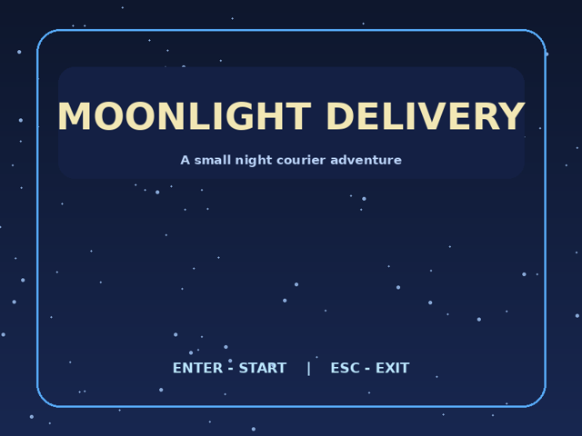

# 달빛 배송작전 (Moonlight Delivery)

C++ / glc2d로 개발하는 2D 수집·회피 아케이드 게임. **현재 2주차: 리소스와 기본 구조 단계**입니다.

## 개발 진행 현황

| 구분 | 상태 |
|---|---|
| 1주차: 기획서 및 움직이는 시제품 | 완료 (`f1`) |
| 2주차: 화면 리소스, 사운드 파일, 클래스 구조 | 코드/파일 준비 (`f2` 예정) |
| 3주차: 수집·충돌·체력·점수·시간 | 예정 |
| 4주차: 스테이지, 난이도, 효과 | 예정 |

## 2주차에서 만든 것

- Title / Playing / GameOver / Clear 상태 및 화면 리소스
- `Game`, `Player`, `FallingObject` 클래스 구분
- 게임 화면 배경, 낙하 오브젝트, 플레이어 이동
- 추후 구현에 사용할 효과음 3종 (재생 로직은 미구현)

## 조작

- **Enter**: 타이틀에서 시작, 결과 화면에서 타이틀 이동
- **WASD / 방향키**: 플레이어 이동
- **Esc**: 플레이 화면에서 타이틀 복귀
- **Space**: 게임오버 **화면 미리보기** (실제 실패 조건 아님)

## Visual Studio 실행 방법

1. `MoonlightDelivery/MoonlightDelivery.sln` 열기
2. Visual Studio 2022에서 NuGet 패키지 복원 (`glc2d`, `Microsoft.DXSDK.D3DX`)
3. `Debug | x64`로 설정, `Ctrl + F5` 실행
4. 이미지가 표시되지 않으면 디버깅 작업 디렉터리가 `MoonlightDelivery` 폴더인지 확인

> 여기서 Windows 환경 빌드 및 실행은 검증하지 못했습니다. VS 설치 및 NuGet 복원 문제는 실제 실행 테스트가 필요합니다.

## 과제 문서

- [1주차 기획서](Docs/Week1_GamePlan.md)
- [2주차 개발 정리](Docs/Week2_Development.md)
- [2주차 화면 미리보기](Docs/Week2_Preview.png)

GitHub 제출은 반드시 기존 **동일한 저장소**에서 진행하고, 파일을 커밋한 뒤 `f2` 태그와 릴리스를 생성합니다. 기존 `f1` 태그는 수정하지 않습니다.
